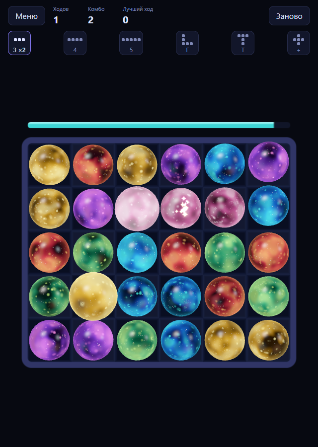
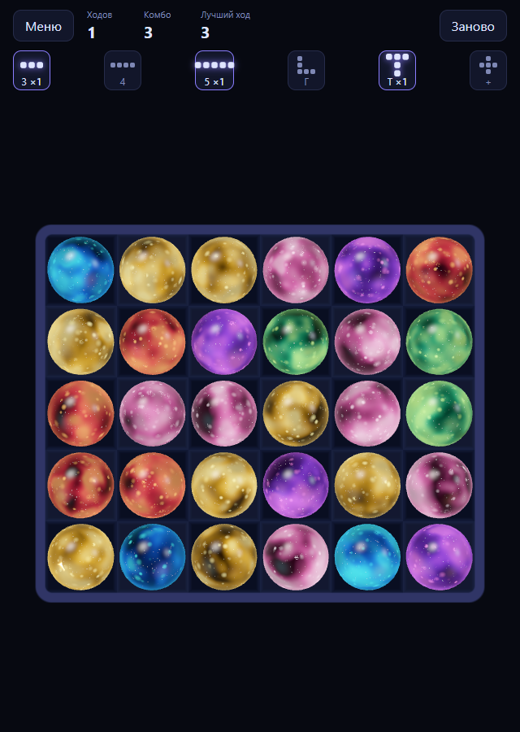

# pkt-3match

<p align="center">
  
  
</p>

**English** · [Русский](README.ru.md)

A match-3 where you grab a ball, drag it through the field (it swaps with everything on its path, as in Puzzle & Dragons) and let go. Built with Vue 3 and Three.js, no sprites: the balls are 3D spheres with a cheap "crystal full of stars" shader, taken from the dice in the sibling project `pkt-dice`.

It replaces an older pixi.js version that stuttered on phones: a handful of bursting balls was enough to drop frames, because every effect was a separate filter pass.

## Run

It uses our shared `@1337exp/pkt-threejs-blueprint` (seeded random), linked from the sibling folder (`file:../pkt-threejs-blueprint`) until it is published: build it once there (`npm install && npm run build`) before `npm install` here.

```bash
npm install
npm run dev
```

Open the address Vite prints. Pick a mode in the menu; the choice lives in the address (`?mode=static`, `?mode=dynamic`), so a link opens straight into it. On a phone: `npm run dev -- --host`.

```bash
npm run typecheck     # vue-tsc --noEmit
npm run test          # vitest
npm run build         # typecheck and production build
npm run screenshot    # docs/media/*.png, needs Chrome or Edge
```

Add `&debug` to the address (`?mode=dynamic&debug`) to see frames per second, draw calls and memory.

## Two modes

| Mode | How it plays |
| --- | --- |
| **Classic** (`src/static`) | Grab, drag, let go, and the whole chain is worked out at once and played back. Input waits while it plays. |
| **Live** (`src/dynamic`) | Input never blocks. Balls fall and burst in real time while you drag another one. |

Both share the field, the clusters, the shapes, the stars shader, the sparks and the move timer (`src/shared`). A mode only decides *when* things fall, burst and block.

**Rules.** A ball bursts when it is in a horizontal or vertical line of three or more of the same colour; crossing and touching lines merge into one cluster. A move has a time limit that starts at your first swap. The row of shapes under the counters shows what can be built (line of 3/4/5, corner, T, cross) and lights up when you build one.

**In Live mode:** the held ball swaps only with standing balls; falling, bursting and empty cells are a wall for it, and it waits. Balls it displaced do not burst until you let go (otherwise a fast drag would blow up everything on its path). Full rules and the numbers: [`docs/modes.md`](docs/modes.md).

## How it is built

- **Logic knows nothing about the screen.** `src/shared/core` is plain TypeScript: the board, clusters, shapes. The Classic mode decides the whole chain first (`Game.release()` returns the steps) and the screen plays it back. The Live mode is a fixed-step simulation (`sim.ts`, 1/60 s) with balls as entities; the screen reads their positions every frame. Both are tested without a renderer.
- **Cheap on a phone.** One `InstancedMesh` per gem type (nine draw calls for the whole screen). No `transmission` (it renders the scene twice) and no post-processing. The depth and the stars are faked inside the shader along a refracted ray, the highlights are formulas. Sparks are one `Points` ring buffer flown entirely in the vertex shader, so a frame allocates nothing.
- **Vue only for the interface.** Three objects stay out of reactivity.

```
src/
  shared/core/     board, clusters, shapes, path, seeded random (pure TS)
  shared/render/   Stage, TileLayer, shaders, sparks, plate, timer bar, tweens
  shared/mode.ts   the interface a mode implements
  static/          Classic mode
  dynamic/         Live mode
  components/      menu, game screen, shapes row
  modes.ts         mode registry (modes load lazily)
docs/              modes.md (rules), roadmap.md (what is next), media/
scripts/           screenshot.mjs
tests/             shared/, static/, dynamic/
```

## Pitfalls we hit

- A ball cut flat at the top of the field was our own clip plane (it hides balls entering from above), not the canvas. The clip now applies only to entering balls, and the camera margin is computed from what really sticks out of the field.
- Two falling balls overlapped for a frame when a fast one inherited its leftover distance into a cell the slower one had just left. A ball is now never closer than one cell to the one below it; a random-play test checks it on every tick.
- "The Live mode feels slow" was not a leak or low FPS but the motion curve: the Classic one starts very fast. Measure before guessing; the numbers are in `docs/modes.md`.
- The pointer leaving the window used to freeze the held ball (a cell-centre check rejected far-away positions). Far points are now clamped to the nearest cell, and a lost pointer capture ends the move.

## Status

A playable core: no background, enemies or bonuses yet. Shapes are only a reference with counters; what each one does is open. Next steps live in [`docs/roadmap.md`](docs/roadmap.md): tuning the Live mode on a real device, shape effects, multi-touch, sounds.

## Us

Homepage: [666.io](https://666.io). If you want to help, suggest an idea or just talk, come by.
