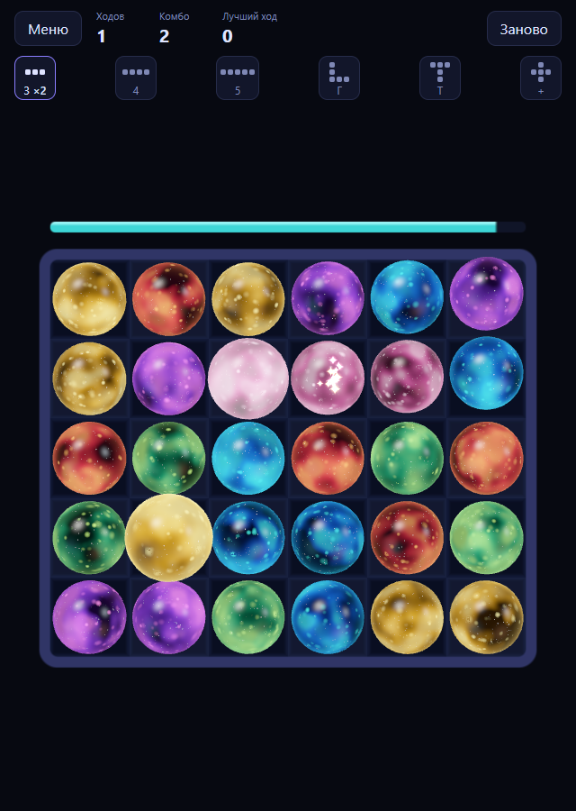
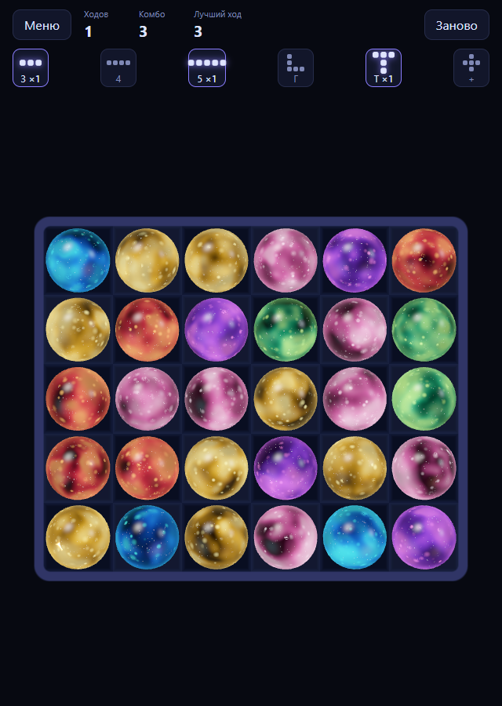

# pkt-3match

<p align="center">
  
  
</p>

[English](README.md) · **Русский**

Три в ряд, где шар хватают, тащат по полю (он меняется местами со всеми на пути, как в Puzzle & Dragons) и отпускают. Vue 3 и Three.js, без спрайтов: шары это 3D-сферы с дешёвым шейдером «кристалл, полный звёзд» из кубиков соседнего проекта `pkt-dice`.

Это замена старой версии на pixi.js, которая тормозила на телефонах: хватало нескольких лопающихся шаров, потому что каждый эффект был отдельным проходом фильтра.

## Запуск

```bash
npm install
npm run dev
```

Откройте адрес, который напечатает Vite. Режим выбирается в меню и хранится в адресе (`?mode=static`, `?mode=dynamic`), так что ссылка открывает сразу его. На телефоне: `npm run dev -- --host`.

```bash
npm run typecheck     # vue-tsc --noEmit
npm run test          # vitest
npm run build         # проверка типов и сборка
npm run screenshot    # docs/media/*.png, нужен Chrome или Edge
```

Добавьте `&debug` к адресу (`?mode=dynamic&debug`), чтобы увидеть кадры в секунду, вызовы отрисовки и память.

## Два режима

| Режим | Как играется |
| --- | --- |
| **Классика** (`src/static`) | Схватил, протащил, отпустил, и вся цепочка считается разом и проигрывается. Пока она идёт, ввод ждёт. |
| **Живой** (`src/dynamic`) | Ввод не блокируется. Шары падают и лопаются в реальном времени, пока вы тащите другой. |

Общее у обоих (`src/shared`): поле, кластеры, фигуры, шейдер звёзд, искры и таймер хода. Режим решает только, *когда* что падает, лопается и блокируется.

**Правила.** Шар лопается, если он в горизонтальной или вертикальной линии из трёх и более одного цвета; пересекающиеся и соприкасающиеся линии склеиваются в один кластер. На ход дано время, оно идёт с первого обмена. Строка фигур под счётчиками показывает, что можно собрать (линия из 3/4/5, угол, Т, крест), и подсвечивается, когда фигура собрана.

**В живом режиме:** схваченный шар меняется только со стоящими шарами; падающие, лопающиеся и пустые клетки для него стена, он ждёт. Сдвинутые им шары не лопаются, пока вы не отпустите (иначе быстрый провод пальца взрывал бы всё на пути). Полные правила и числа: [`docs/modes.md`](docs/modes.md).

## Как устроено

- **Логика ничего не знает про экран.** `src/shared/core` это чистый TypeScript: поле, кластеры, фигуры. «Классика» сначала решает всю цепочку (`Game.release()` возвращает шаги), экран её проигрывает. «Живой» это симуляция с фиксированным шагом (`sim.ts`, 1/60 с), где шары это сущности; экран каждый кадр читает их положения. Оба режима тестируются без рендера.
- **Дёшево на телефоне.** Один `InstancedMesh` на тип камня (девять вызовов отрисовки на весь экран). Никакого `transmission` (он рисует сцену дважды) и постпроцессинга. Глубина и звёзды подделаны в шейдере по преломлённому лучу, блики это формулы. Искры это один кольцевой буфер `Points`, весь полёт в вершинном шейдере, в кадре нет аллокаций.
- **Vue только для интерфейса.** Объекты Three в реактивность не попадают.

```
src/
  shared/core/     поле, кластеры, фигуры, путь, зерно (чистый TS)
  shared/render/   Stage, TileLayer, шейдеры, искры, плита, полоска времени, твины
  shared/mode.ts   интерфейс, который реализует режим
  static/          режим «Классика»
  dynamic/         режим «Живой»
  components/      меню, экран игры, строка фигур
  modes.ts         реестр режимов (режимы грузятся лениво)
docs/              modes.md (правила), roadmap.md (что дальше), media/
scripts/           screenshot.mjs
tests/             shared/, static/, dynamic/
```

## Грабли, на которые наступили

- Шар, срезанный ровно по верху поля, это был наш собственный клип (он прячет шары, въезжающие сверху), а не холст. Теперь клип действует только на въезжающие шары, а запас кадра у камеры считается из того, что реально выступает за поле.
- Два падающих шара на кадр накладывались, когда быстрый переносил остаток пути в клетку, которую медленный только что освободил. Теперь шар никогда не ближе клетки к нижнему; тест случайной игры проверяет это на каждом тике.
- «Живой режим вялый» оказалось не утечкой и не низким FPS, а кривой движения: у классики очень резкий старт. Сначала мерить, потом гадать; числа в `docs/modes.md`.
- Курсор, ушедший за окно, замораживал схваченный шар (проверка «близко к центру клетки» отбрасывала далёкие точки). Теперь далёкие точки прижимаются к ближайшей клетке, а потеря захвата указателя заканчивает ход.

## Состояние

Играбельное ядро: пока без фона, врагов и бонусов. Фигуры это справка со счётчиками, что каждая даёт, ещё открытый вопрос. Дальше: [`docs/roadmap.md`](docs/roadmap.md) (подстройка «Живого» на реальном устройстве, эффекты фигур, несколько касаний, звуки).

## Мы

Домашняя страница: [666.io](https://666.io). Хотите помочь, предложить идею или просто поговорить — заходите.
